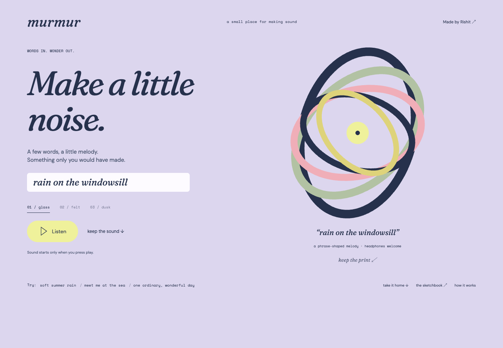

# Murmur

A phrase-to-melody instrument with a visible sound sculpture.

**[Try it now](https://murmur-rishit.rishit-pradhan.chatgpt.site)** · [Download locally](https://github.com/rishitpradhan-gif/murmur/releases/latest) · [Figma design](https://www.figma.com/design/DBcxizG8kBipgkuMaUv2TU?node-id=3-26)



[Original Figma composition](docs/figma-design.png) · [Mobile interface](docs/screenshots/mobile.png)

## Try it

Write a short phrase, choose glass/felt/dusk, and press Listen. Keep the generated WAV audio or SVG print. Sound never starts automatically. The instrument maps character codes into a pentatonic scale; it does not interpret emotional meaning, synthesize speech, or use a remote model. Up to 80 Unicode code points are considered; at most 48 notes are played. The same normalized phrase and texture produce the same audio. The view pauses sound when the tab is hidden.

## Run the download

Download the local ZIP from Releases, extract it, and open a terminal in the folder containing `serve.py`:

```sh
python3 serve.py
```

On Windows use `py -3 serve.py`. Open http://127.0.0.1:8000. Python 3.10+ is enough; no npm installation is needed for the prebuilt download. Keep the terminal open; Ctrl+C stops it. Use `--port 8001` if port 8000 is busy.

## Develop

Node.js 22.17+, npm:

```sh
npm ci
npm run dev
node --test engine/test.mjs
npm run build
```

For a portable build: `node node_modules/vite/bin/vite.js build --config standalone/vite.config.mjs`. The website uses the supported Sites/Vinext starter; the portable build uses the same React view and engine in a static shell.

## Privacy and implementation

Phrase/photo processing happens in this browser. No file upload, microphone, account, API key, or external inference service is required. The website loads typefaces from Google Fonts; an offline download falls back to local serif/sans-serif fonts. Exported SVG text uses portable font fallbacks. Supported browsers need SVG, downloads, modern JavaScript, and (for playback) Web Audio; photo extraction also needs ImageBitmap/Canvas support.

## Design and provenance

The editable Figma file was created and visually checked before the website implementation. See docs/design.md for the design-to-code handoff limitation. Rishit Pradhan directed the work; implementation and design construction were AI-assisted. These are original small software implementations using established sonification, synthesis, quantization, and SVG techniques; worldwide novelty is not claimed.

MIT licensed; dependency and typeface licenses remain their own.

## Verification

Engine tests and real headless Chrome interaction checks passed, including playback/photo input, downloaded exports, mobile overflow, and reduced motion where applicable. Screenshots and browser-verification.json are in docs/. The interactive browser tool was unavailable due to a workspace symlink; the existing Playwright/Chrome harness completed the checks.
